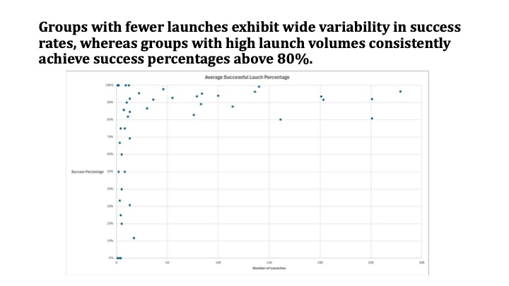
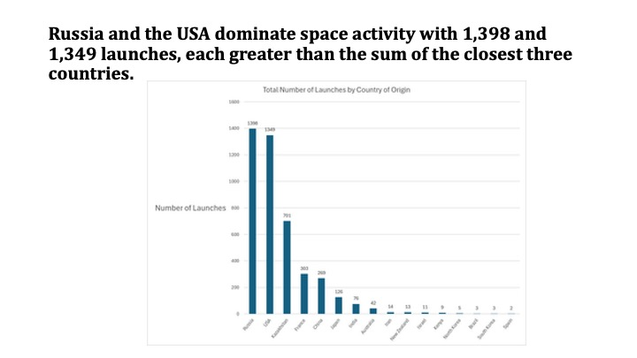
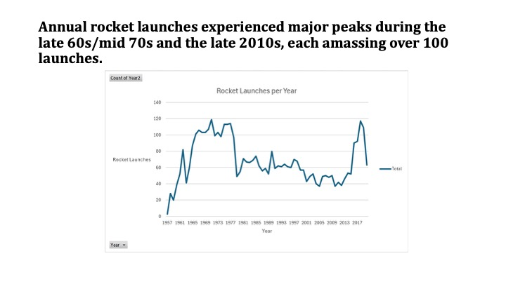
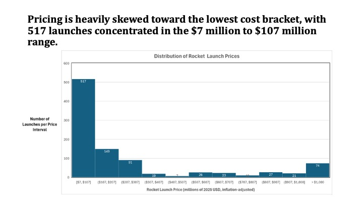

Authors - [Jordan Sheely]https://jordanlsheely.github.io/jordanlsheely/)-[Austin Horton](https://austin-horton.github.io/)-[Elliot Boyd](http://elliottboyd.github.io/)-[Carter Flynt](https://carterflynt.github.io/)-[Jace Keller](https://jace1206.github.io/)

## DATA SET

The data set covered was a kaggle data set on Space Mission launches, includes all of the space missions that have been launched since the beginning of Space Race in 1957! - [Dataset](https://www.kaggle.com/datasets/salmane/space-missions-launches)

##Does experience affect success rate?

Question: Does a country’s number of space launches affect its success rate? This is interesting because the news rarely covers smaller companies/countries launching rockets.

Method: We made a pivot table of launch status by country of origin, then divided successes by total launches to get a success rate. We plotted launches against success rate in a scatter plot.

Finding: The two variables appear to follow a logarithmic distribution.

##Which countries launch the most?

Question: Do certain countries launch more rockets than others? This is interesting because it shows the scope of just how many rockets are have been launched by each countries.

Method: We built a pivot table of total launches per country and charted the most active launching countries in a bar chart.

Finding: Russia and the USA have a much higher presence in space launches than any other country.

##How have launches changed over time?

Question: What is the historical distribution of annual space launches? This is interesting because the world’s captivation with space has shifted a lot over time..

Method: We filtered the data to the relevant columns, used a pivot table to count launches per year, and graphed count vs. year.

Finding: There were two major spikes in rocket launches within the past 70 years. One during the space race (60s-70s) and in the laste 2010s.

##How much do launches cost?

Question: What is the statistical distribution of rocket launch prices?

Method: We adjusted each launch’s cost to 2025 dollars using each year’s CPI, then grouped the launches into price bins and counted them.

Finding: Nearly all rocket launches cost $7 million to $107 million (in 2025 dollars).

Note: Many launches had no listed price and were excluded.
